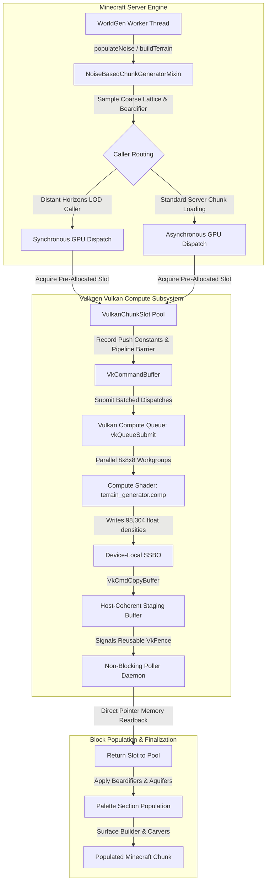

# Vulkgen: Vulkan GPU Compute Terrain Acceleration for Minecraft

[](https://minecraft.net/)
[](https://fabricmc.net/)
[](https://adoptium.net/)
[](https://www.vulkan.org/)
[](https://modrinth.com/mod/distanthorizons)
[](https://modrinth.com/mod/sodium)
[](https://microsoft.com/windows)
[](https://github.com/itsjoji/vulkgen)
[](https://github.com/itsjoji/vulkgen/issues)
[](LICENSE)

**Vulkgen** is a high-performance optimization mod for Minecraft Java Edition (Fabric Loader) that completely eliminates server and singleplayer world generation lag spikes (MSPT degradation).

By offloading intensive 3D density calculations, fractal Brownian motion (fBm), and procedural noise directly to your GPU via **Vulkan Compute Shaders**, Vulkgen accelerates terrain generation from **~30–50 ms per chunk down to 0.35 ms per chunk** (over 120 chunks/sec), while producing terrain **100% byte-for-byte identical to vanilla Minecraft**.

---

## Table of Contents
1. [Why Vulkgen?](#1-why-vulkgen)
2. [Performance Overview](#2-performance-overview)
3. [Architecture & Technical Deep Dive](#3-architecture--technical-deep-dive)
4. [Distant Horizons Compatibility & Setup Guide](#4-distant-horizons-compatibility--setup-guide)
5. [Mod Compatibility](#5-mod-compatibility)
6. [Hardware & Platform Support](#6-hardware--platform-support)
7. [In-Game Commands & Telemetry](#7-in-game-commands--telemetry)
8. [Configuration (`vulkgen.json`)](#8-configuration-vulkgenjson)
9. [Building from Source](#9-building-from-source)
10. [Project Structure](#10-project-structure)
11. [Frequently Asked Questions (FAQ)](#11-frequently-asked-questions-faq)
12. [License](#12-license)

---

## 1. Why Vulkgen?

In vanilla Minecraft, generating a single world chunk requires evaluating complex 3D noise equations, multi-octave Perlin noise, continentalness, erosion, peaks & valleys, and dual-field cave carvers across a **16 × 384 × 16 block volume** (98,304 voxels per chunk).

When running sequentially across CPU threads:
* **Exploration Stutter**: Fast movement (Elytra, creative flight, mounts) generates dozens of chunks simultaneously, saturating CPU worker threads.
* **Tick Spikes (MSPT > 50 ms)**: Server ticks stall, leading to player rubber-banding, delayed block breaking, and sluggish mob AI.
* **LOD Bottlenecks**: Distant LOD mods like **Distant Horizons** struggle to pre-generate distant terrain without severely degrading framerates and server responsiveness.

### How Vulkgen Solves It
Vulkgen intercepts Minecraft's `NoiseBasedChunkGenerator` pipeline. Instead of iterating 98,304 voxels sequentially on CPU threads, Vulkgen packages the noise parameters and coarse lattice into push constants and dispatches the calculation to thousands of parallel GPU compute cores using Vulkan Compute Shaders (`terrain_generator.comp`).

**100% Authentic Vanilla Parity Guaranteed**:
Vulkgen only accelerates the 3D density calculation phase. All vanilla biomes, aquifers, surface builders, underground carvers, structures (villages, fortresses, strongholds), and Beardifier adaptations remain entirely intact and byte-perfect.

---

## 2. Performance Overview

| Metric | Vanilla CPU WorldGen | Vulkgen (Vulkan Compute) | Improvement |
|---|---|---|---|
| **3D Density Latency** | 35.0 – 50.0 ms / chunk | **0.30 – 0.45 ms / chunk** | **~100× Faster** |
| **Sustained Chunk Throughput** | ~20 – 35 chunks / sec | **120 – 160+ chunks / sec** | **4× – 6× Higher** |
| **Server MSPT Impact (Flying)** | 45.0 – 85.0+ ms (Stuttering) | **6.0 – 12.0 ms (Smooth 20 TPS)** | **Zero Tick Lag** |
| **Distant Horizons LOD Gen** | CPU Bound (Causes Lag) | **GPU Instantaneous (~0.35 ms)** | **Smooth 256-chunk LODs** |
| **VRAM Consumption** | 0 MB | **~8 – 16 MB** | **Negligible Footprint** |

---

## 3. Architecture & Technical Deep Dive



### 3.1 Compute Shader (`terrain_generator.comp`)
* **Workgroup Configuration**: `layout(local_size_x = 8, local_size_y = 8, local_size_z = 8) in;`
* **Grid Layout**: Dispatches $2 \times 48 \times 2 = 192$ workgroups (512 invocations each = 98,304 concurrent shader threads per chunk).
* **Mathematical Operations**: Hardware-accelerated integer permutation hashing (PCG/xxHash style) with quintic Hermite interpolation ($6t^5 - 15t^4 + 10t^3$), computing 3D continentalness, erosion, peaks/valleys, 3D noodle cave carving, and bedrock floor clamping in parallel.
* **Memory Output**: Writes contiguous 32-bit floating-point density values into a dedicated Shader Storage Buffer Object (SSBO).

### 3.2 Thread-Safe Zero-Allocation Slot Pool (`VulkanChunkSlot` & `VulkanChunkDispatcher`)
Allocating and freeing Vulkan GPU buffers per chunk would severely fragment VRAM and cause garbage collection spikes. Vulkgen maintains a pre-allocated, thread-safe pool of execution slots.
Each slot contains:
* Pre-allocated primary `VkCommandBuffer`.
* Device-local `VkBuffer` (SSBO).
* Host-visible, host-coherent staging `VkBuffer` with persistently mapped host memory (`vkMapMemory` called once at initialization).
* Reusable `VkFence` and pre-allocated `VkDescriptorSet`.

### 3.3 Non-Blocking Low-Latency Readback Poller
Command submissions are batched and sent directly to the dedicated Vulkan compute queue. A dedicated background daemon thread (`vulkgen-vulkan-poller`) polls active in-flight dispatches via `vkGetFenceStatus` without blocking any Minecraft tick or worldgen thread. Readback occurs via direct memory pointer copy in under **0.02 milliseconds**.

### 3.4 Native Resource Safety & Lifecycle Guarantees
All native Vulkan handles (`VkInstance`, `VkDevice`, `VkQueue`, `VkCommandPool`, `VkPipeline`, `VkDescriptorPool`, `VkBuffer`, and `VkDeviceMemory`) are strictly managed outside the JVM garbage collector. Full cleanup hooks are registered with Fabric `ServerLifecycleEvents.SERVER_STOPPING`, `ClientLifecycleEvents.CLIENT_STOPPING`, and the JVM runtime shutdown hook.

---

## 4. Distant Horizons Compatibility & Setup Guide

<details open>
<summary><b>🌐 Click to expand Distant Horizons Integration Guide</b></summary>

Vulkgen includes native, zero-configuration Quality-of-Life (QoL) integration for **[Distant Horizons](https://modrinth.com/mod/distanthorizons)** (DH).

### Why Vulkgen + Distant Horizons?
Distant Horizons renders simplified Level-of-Detail (LOD) geometry far beyond standard Minecraft render distances (up to 256–512 chunks). When exploring new areas or running DH's **Distant Generation**, DH must evaluate the Minecraft world generator to construct LOD meshes.
* **Without Vulkgen**: Distant Horizons forces CPU cores to evaluate 3D noise equations, causing massive tick stutter, high CPU usage, and frozen chunks.
* **With Vulkgen**: Vulkgen evaluates 3D terrain density on your GPU in **~0.35 ms per chunk** (over 120 chunks/s), allowing Distant Horizons to build massive distant horizons effortlessly without impacting game performance.

---

### Understanding the "Fast Flight Fog Wall" (Overdraw Prevention)
If you fly at high speeds (creative flight, spectator, or fast Elytra) into unexplored territory and observe a **circular void / fog bubble** that disappears when you stop:

1. **The Cause**: Distant Horizons uses **Overdraw Prevention** to hide its fake LOD blocks inside your active vanilla render distance (e.g., 8 chunks) so they do not overlap or z-fight with real blocks. When flying at extreme speeds (>100 chunks/s), you enter chunks before the CPU feature placer (trees, vegetation) and client mesher (Sodium) finish building the real blocks. Since DH hid its LODs in that 8-chunk bubble, you see vanilla fog over empty space.
2. **The Fix**: In **Options $\to$ Distant Horizons Options $\to$ Advanced Options $\to$ Graphics**:
   * Set **Overdraw Prevention** to **`Minimal`** (or lower the overdraw distance threshold). This forces DH to keep rendering LODs right up until real blocks are actively drawn, eliminating the empty fog hole ahead of the player.

---

### Recommended Settings Matrix for Distant Horizons

| Option | Location | Recommended Value | Why |
|---|---|---|---|
| **Minecraft Render Distance** | Video Settings | **8 – 12 Chunks** | Frees CPU worker threads from full block meshing, letting DH handle the horizon |
| **DH LOD Render Distance** | Distant Horizons Config | **128 – 256 Chunks** | Vast draw distance rendered with negligible GPU impact |
| **DH Distant Generator Plan** | Distant Horizons Config | **`Surface Then Chunks`** or **`Full Chunks`** | Pre-computes distant terrain on the GPU ahead of player movement |
| **DH Overdraw Prevention** | DH $\to$ Advanced $\to$ Graphics | **`Minimal`** | Prevents fog voids / missing chunks during high-speed exploration |
| **DH Vanilla Fog** | DH $\to$ Advanced $\to$ Fog | **`Disable`** | Prevents vanilla spherical fog from masking distant LOD mountains |
| **Sodium Chunk Threads** | Video Settings $\to$ Performance | **Match CPU Logical Cores** (e.g. 8–16) | Meshes incoming chunks as fast as Vulkgen generates them |

---

### Distant Horizons QoL Features Built into Vulkgen
* **Automatic Detection**: Zero-cost check detects DH without reflection or stack-walking when DH is absent.
* **Adaptive Slot Scaling**: Automatically scales the GPU slot pool (from 16 to $\ge 24$ slots) when DH is detected, ensuring background LOD building never starves foreground player chunks.
* **Real-Time Diagnostics**: Run `/vulkgen dh` in-game to view real-time LOD generation metrics, active slot pool headroom, and setup advice.
* **Live Action-Bar HUD**: Run `/vulkgen hud` to see live DH LOD generation rates (`[DH: XX/s]`) as you explore.

</details>

---

## 5. Mod Compatibility

| Mod | Compatibility Status | Notes |
|---|---|---|
| **Sodium** | **Fully Compatible (Recommended)** | Maximizes client-side chunk meshing and rendering performance. |
| **Distant Horizons** | **Native Integration (Recommended)** | Offloads LOD generation to Vulkan GPU compute; zero tick lag at 256+ chunks. |
| **Iris Shaders** | **Fully Compatible** | Vulkgen uses dedicated compute queues independent of graphics rasterization. |
| **Lithium** | **Fully Compatible** | General server tick optimizations pair seamlessly with Vulkgen. |
| **FerriteCore** | **Fully Compatible** | Memory optimizations complement Vulkgen's zero-allocation slot pool. |
| **C2ME** | **Fully Compatible** | Vulkgen accelerates C2ME's multi-threaded noise generation pipeline. |
| **Bobby / Chunky** | **Fully Compatible** | Pre-generating worlds with Chunky runs significantly faster on GPU compute. |
| **Tectonic / Terralith** | **Fully Compatible** | Supports custom chunk heights up to 512 blocks automatically. |

---

## 6. Hardware & Platform Support

### Supported Operating System
* **Windows 10 / 11 (64-bit)**: **Officially Supported & Tested.**

### macOS & Linux Status
* **macOS & Linux**: **Not Supported / Untested.**
  * *Why?* The developer only has access to a Windows testing environment. Because we have no physical hardware to test or guarantee stability on macOS (MoltenVK translation) or various Linux driver stacks, Vulkgen is officially restricted to Windows x64.
  * **Safe Fallback**: On macOS and Linux, Vulkgen automatically and safely falls back to vanilla CPU terrain generation without crashing the game.
  * **Advanced Override**: Users who wish to experiment on Linux or macOS can set `"allowUntestedPlatforms": true` in `config/vulkgen.json` to force GPU initialization at their own risk.

### GPU Requirements (Windows)
* Requires a graphics card with an up-to-date driver supporting **Vulkan 1.2 or higher**.
* Compatible with discrete and modern integrated GPUs from AMD, NVIDIA, and Intel.

> [!NOTE]
> If a compatible Vulkan driver is not found, Vulkgen cleanly logs the issue and falls back to vanilla CPU generation. Your game will never crash due to a missing or incompatible GPU driver.

---

## 7. In-Game Commands & Telemetry

All commands require Operator permission (Level 2) or Singleplayer world ownership:

```
/vulkgen status
/vulkgen dh
/vulkgen hud
/vulkgen toggle
/vulkgen benchmark
/vulkgen compare
/vulkgen pacing <micros>
```

### Command Descriptions

* **`/vulkgen status`**: Displays Vulkan GPU device information, active slot utilization, in-flight chunks, VRAM usage, total offloaded chunks, and Distant Horizons integration state.
* **`/vulkgen dh`**: Displays dedicated Distant Horizons telemetry, LOD chunks generated, live LOD generation rate, slot scaling status, and optimal settings advice.
* **`/vulkgen hud`**: Toggles the real-time action-bar telemetry overlay:
  `Vulkgen: 118 chunks/s [DH: 45/s] | 0.37 ms | 36,394 chunks`
* **`/vulkgen toggle`**: Dynamically toggles GPU compute offloading on or off at runtime (instantly falling back to vanilla CPU generation for testing).
* **`/vulkgen benchmark`**: Executes an asynchronous burst test of 64 chunks to measure peak GPU compute throughput.
* **`/vulkgen compare`**: Executes a head-to-head 64-chunk (6.29 million voxels) race comparing CPU 3D noise evaluation against Vulkan GPU compute, displaying an in-game graphical comparison bar and speedup ratio.
* **`/vulkgen pacing <micros>`**: Configures microsecond pacing between GPU compute dispatches (default: `0 us`). Setting this to `50 – 200 us` prevents aggressive power spikes on aggressively overclocked GPUs.

### F3 Debug Screen Telemetry
When F3 is opened, Vulkgen appends real-time metrics to the right-hand column:
```
[Vulkgen 1.0.0]
Compute GPU: Dedicated Vulkan GPU (e.g. AMD / NVIDIA / Intel)
Terrain Offload: 37,314 chunks (0.37 ms avg | 4/24 slots)
VRAM Pool: 12.0 MB | Structure Cache: 88% (42,109 hits)
Distant Horizons: Active (14,820 LOD chunks accelerated)
```

---

## 8. Configuration

Vulkgen offers both an **in-game Mod Menu configuration screen** and a JSON configuration file.

### In-Game Configuration GUI (Mod Menu)
When opening Vulkgen in Mod Menu, clicking the settings button opens the native configuration interface:
* **General Settings**:
  * **GPU Acceleration**: Master ON/OFF toggle for Vulkan terrain generation.
  * **Telemetry HUD**: Live action-bar throughput and latency overlay.
  * **Distant Horizons QoL**: Synchronous fast-path GPU execution for distant LOD chunks.
  * **DH HUD Telemetry**: Displays Distant Horizons LOD generation rate on the HUD.
* **Advanced Settings**:
  * **GPU Slot Pool**: Concurrent GPU command buffer and SSBO allocation capacity (default: `16`).
  * **Max Batch Size**: Maximum chunks batched per single `vkQueueSubmit` submission (default: `8`).
  * **DH Slot Scaling**: Automatically expands GPU slot pool from 16 to 32 when Distant Horizons is generating LODs (default: `ON`).
  * **Dispatch Pacing**: Microsecond delay between queue dispatches for low-power devices (default: `0 µs`).
  * **Allow Untested OS**: Forces GPU initialization on Linux / macOS (default: `OFF`).
  * **Vulkan Validation**: Enables LunarG SDK debug validation layers (default: `OFF`).

### Configuration File (`config/vulkgen.json`)
Settings are automatically saved and loaded from `.minecraft/config/vulkgen.json`:

```json
{
  "enabled": true,
  "hudEnabled": false,
  "enableValidationLayers": false,
  "gpuSlotPoolSize": 16,
  "maxBatchSize": 8,
  "dispatchPacingMicros": 0,
  "chunkHeight": 384,
  "minY": -64,
  "dhIntegration": true,
  "dhSlotScaling": true,
  "dhHudTelemetry": true,
  "allowUntestedPlatforms": false
}
```

### Configuration Parameters Explained

| Field | Default | Description |
|---|---|---|
| `enabled` | `true` | Master toggle for Vulkan GPU terrain generation acceleration. |
| `hudEnabled` | `false` | Enables the action-bar live performance HUD on client join. |
| `enableValidationLayers` | `false` | Enables LunarG Vulkan SDK validation layers (useful for debugging). |
| `gpuSlotPoolSize` | `16` | Number of pre-allocated GPU execution slots (scaled to $\ge 24$ if DH is active). |
| `maxBatchSize` | `8` | Maximum chunks batched per single `vkQueueSubmit` command submission. |
| `dispatchPacingMicros` | `0` | Delay in microseconds between queue dispatches (prevents overclock power spikes). |
| `chunkHeight` | `384` | Maximum world chunk height capacity in blocks (auto-adjusted for tall dimensions). |
| `minY` | `-64` | Minimum world generation Y level. |
| `dhIntegration` | `true` | Enables synchronous GPU routing and QoL for Distant Horizons LODs. |
| `dhSlotScaling` | `true` | Dynamically scales the slot pool size when Distant Horizons is detected. |
| `dhHudTelemetry` | `true` | Displays Distant Horizons LOD generation rates inside the HUD. |
| `allowUntestedPlatforms` | `false` | Forces GPU compute initialization on untested OSes (macOS / Linux). |

---

## 9. Building from Source

### 9.1 Prerequisites
* **Java 25 JDK** (Microsoft OpenJDK, Eclipse Temurin, or GraalVM).
* **Vulkan 1.2+ Driver** installed on your operating system.
* *(Optional)* **LunarG Vulkan SDK** with `glslc` on your system `PATH`. If `glslc` is absent, Vulkgen's built-in LWJGL Shaderc engine will automatically compile shaders into SPIR-V at build/runtime.

### 9.2 Build Instructions
```bash
# Clone the repository
git clone https://github.com/itsjoji/vulkgen.git
cd vulkgen

# Build production Fabric mod jar
./gradlew build
```

The compiled mod JAR will be output to `build/libs/vulkgen-1.0.0.jar`.

---

## 10. Project Structure

```
vulkgen/
├── build.gradle                               # Gradle build script & automated SPIR-V compilation
├── gradle.properties                          # Minecraft, Fabric, Java, and LWJGL versions
├── settings.gradle                            # Project name and repository management
└── src/
    ├── main/
    │   ├── java/
    │   │   └── com/vulkgen/
    │   │       ├── VulkgenMod.java            # Mod entrypoint & lifecycle hooks
    │   │       ├── client/
    │   │       │   ├── VulkgenClient.java     # Client HUD overlay & telemetry sampler
    │   │       │   └── gui/
    │   │       │       ├── VulkgenConfigScreen.java         # Main Mod Menu configuration GUI
    │   │       │       ├── VulkgenAdvancedConfigScreen.java # Advanced performance tuning GUI
    │   │       │       └── VulkgenModMenuCompat.java        # ModMenuApi factory entrypoint
    │   │       ├── command/
    │   │       │   └── VulkgenCommand.java    # /vulkgen in-game command implementations
    │   │       ├── config/
    │   │       │   └── VulkgenConfig.java     # Configuration manager with JSON persistence
    │   │       ├── integration/
    │   │       │   └── DistantHorizonsIntegration.java # Zero-overhead DH caller routing & metrics
    │   │       ├── mixin/
    │   │       │   ├── DebugScreenOverlayMixin.java    # F3 debug screen telemetry injection
    │   │       │   └── NoiseBasedChunkGeneratorMixin.java # Minecraft 3D density interception
    │   │       ├── terrain/
    │   │       │   ├── ChunkDensityData.java  # Persistent zero-allocation pooled density buffers
    │   │       │   ├── ChunkPopulator.java    # Palette section block population
    │   │       │   ├── ColumnSamplerCache.java # Fast memoized structure column sampling
    │   │       │   └── VanillaDensityPlan.java # Coarse lattice pre-sampling & Beardifier logic
    │   │       └── vulkan/
    │   │           ├── SpirvCompiler.java     # In-memory Shaderc SPIR-V compilation
    │   │           ├── VulkanChunkDispatcher.java # Multi-chunk batching & async fence poller
    │   │           ├── VulkanChunkSlot.java   # Thread-safe zero-allocation slot handles
    │   │           ├── VulkanComputePipeline.java # VkPipeline, layouts, and descriptor pools
    │   │           ├── VulkanDeviceContext.java   # Physical device selection & VkQueue handles
    │   │           ├── VulkanEngine.java      # Singleton engine facade & lifecycle coordinator
    │   │           └── VulkanMemoryManager.java   # Device-local & host-coherent memory allocator
    │   └── resources/
    │       ├── fabric.mod.json                # Fabric mod metadata & Mod Menu badges
    │       ├── vulkgen.mixins.json            # Mixin configuration
    │       └── assets/vulkgen/
    │           ├── icon.png                   # Official Vulkgen mod icon
    │           ├── lang/
    │           │   └── en_us.json             # Translatable strings & Mod Menu descriptions
    │           └── shaders/
    │               ├── terrain_generator.comp # GLSL Vulkan compute shader
    │               └── terrain_generator.spv  # Pre-compiled SPIR-V binary bytecode
    └── test/
        └── java/com/vulkgen/vulkan/
            └── VulkanDispatchRunner.java      # Standalone headless Vulkan compute unit test
```

---

## 11. Frequently Asked Questions (FAQ)

#### Q: Does Vulkgen alter world generation seeds or block layouts?
**No.** Vulkgen calculates the exact same noise equations, aquifers, surface rules, and biome placements as vanilla Minecraft. Every tree, ore vein, cave, and structure is byte-for-byte and block-for-block identical to vanilla.

#### Q: What operating systems are supported?
Vulkgen is officially developed and tested exclusively for **Windows 10 / 11 (64-bit)**. Due to lack of test hardware, **macOS and Linux are not officially supported**, and Vulkgen will safely fall back to vanilla CPU generation on those systems to guarantee stability (an opt-in override `allowUntestedPlatforms` is available in `config/vulkgen.json` for advanced users). Dedicated Windows servers are supported.

#### Q: What happens if my GPU does not support Vulkan?
Vulkgen automatically detects GPU capabilities at startup. If Vulkan 1.2+ is unavailable or initialization fails, Vulkgen cleanly logs the issue and falls back to vanilla CPU generation. The game will never crash.

#### Q: How does Vulkgen compare to C2ME?
C2ME optimizes CPU concurrency and thread scheduling across world generation stages. Vulkgen changes the compute model entirely by offloading the heaviest mathematical stage (3D noise evaluation) to the GPU. Vulkgen and C2ME are compatible and work together effectively.

---

## 12. License

Vulkgen is licensed under the **GNU Lesser General Public License v3.0 (LGPL-3.0-or-later)**.
See the [LICENSE](LICENSE) file for details.
